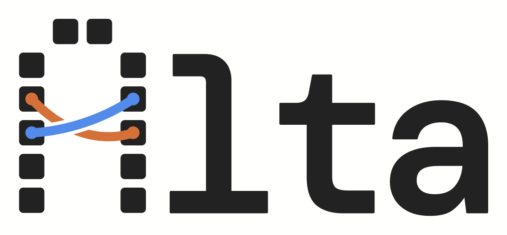
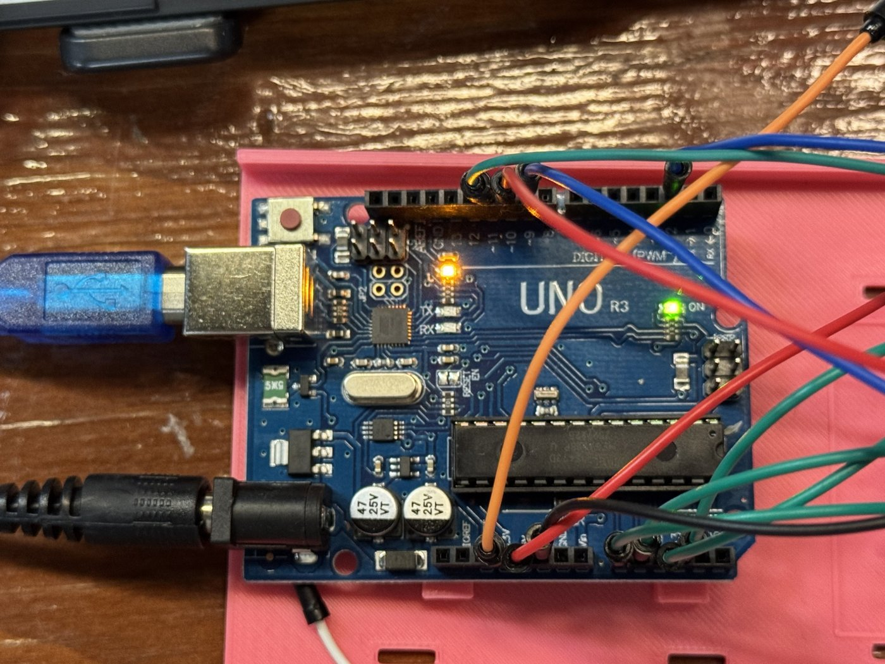
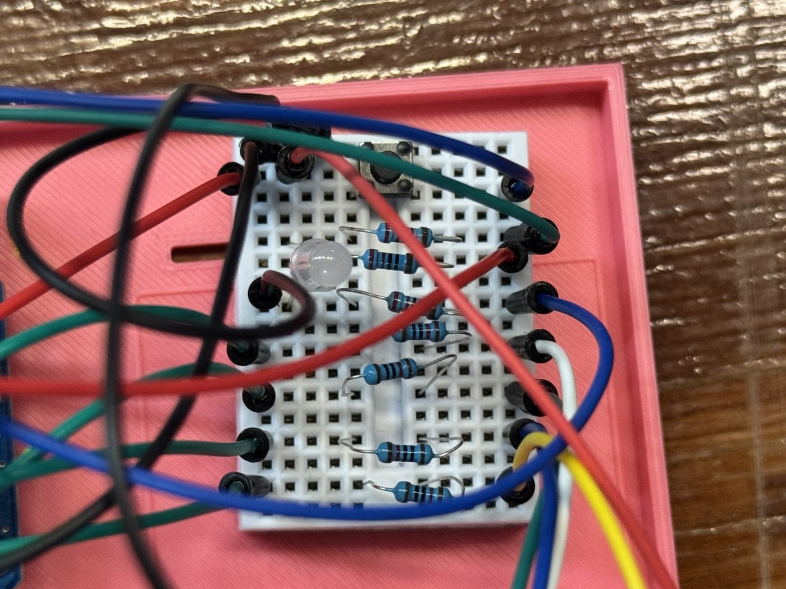

<h1 align="center"></h1>

**ALTA (AI Lab Teaching Assistant)** is a voice-driven lab TA for intro
electronics. It **measures** the student's breadboard through a probe pod,
**talks** with the student by voice, and **walks them to the fault** the way a
good TA does: by asking for a measurement, asking a question, and pointing at
the spot, without handing over the answer.

Built in 36 hours at **Cal Hacks 13.0** by a team of four.


---

## Table of contents

- [The problem](#the-problem)
- [Version 1.0: what works today](#version-10-what-works-today)
- [How it works](#how-it-works)
- [What a session sounds like](#what-a-session-sounds-like)
- [The agent](#the-agent)
- [Voice: the Cartesia features we use](#voice-the-cartesia-features-we-use)
- [Hardware and firmware](#hardware-and-firmware)
- [Measured results](#measured-results)
- [Where it could go wrong](#where-it-could-go-wrong)
- [Known limitations](#known-limitations)
- [Privacy and accessibility](#privacy-and-accessibility)
- [Requirements](#requirements)
- [Setup and run](#setup-and-run)
- [Repository layout](#repository-layout)
- [Team](#team)

---

## The problem

In an intro electronics lab, one TA looks after a room full of students, and
most of them get stuck on the same handful of mistakes: an LED in backwards, a
resistor with the wrong color bands, a ground wire that never made it into the
rail. A student can wait ten minutes for a TA who then finds the problem in
thirty seconds, often by doing it for them, so the student learns nothing.

ALTA is the TA that's already at the bench. It doesn't guess from a photo or
from what the student says: it asks them to put a probe in a row, reads the real
voltage, and teaches from that reading.

## Version 1.0: what works today

This is the version we demoed. Here is what it does, and what it doesn't do
yet, stated plainly:

- **Voice, probes and teaching work end to end on real hardware.** Push to
  talk, ALTA asks for a probe, reads the voltage, gives a hint, and confirms the
  fix by itself when the reading changes. 3 of 3 timed runs on the real board
  found and fixed the fault with no errors (see [Measured results](#measured-results)).
- **Two labs.** Lab 1 (light an LED) is verified on the real board. Lab 2
  (light sensor) passes our simulated tests but hasn't been checked on hardware
  yet.
- **The camera is a live view, not a sensor yet.** The phone camera streams the
  board to the screen, but mapping camera pixels to breadboard holes isn't
  accurate enough: highlights land in the wrong place. ALTA therefore teaches
  from probe readings and what the student tells it. Letting ALTA look and
  point by itself is built but **off by default** (`BENCH_WATCH=1` turns it on).
- **Needs the internet.** Claude and Cartesia run in the cloud.
- **One station per laptop.** The TA dashboard shows the live station plus five
  replayed ones; a real room would need a shared server.

The full list is under [Known limitations](#known-limitations).


## How it works


The real bench, seen from above:


Six things on the desk, each doing a job a human TA would do:

| # | Part | Is ALTA's... | What it does |
| --- | --- | --- | --- |
| 1 | Phone camera on a stand | eyes | Streams the board, seen from straight above, to the student screen |
| 2 | Lab breadboard | student's workbench | The circuit the student builds from the lab manual |
| 3 | Probe pod | multimeter | An Arduino Uno running our own bare-metal C. It reads 4 probe wires about 1,200 times a second each and sends the voltages to the laptop 20 times a second. It also has the push-to-talk button and a status light |
| 4 | Probe wires | multimeter tips | Four colored wires (yellow, blue, green, white). When ALTA says "put the yellow probe in row 15", the student does, and ALTA reads that row's voltage |
| 5 | Power wires | bench power supply | The pod powers the lab board at a safe 5 V and shares its ground |
| 6 | Laptop | brain, voice and screen | Runs the server, Claude, voice in and out, and the student screen |

**One turn, step by step:**

1. The student holds the button and says "my LED won't light".
2. Cartesia's speech-to-text transcribes it in about half a second.
3. Claude decides what to measure first and asks for one probe at one row. The
   screen shows the expected voltage band on that probe's gauge.
4. Cartesia speaks the reply sentence by sentence while Claude is still writing
   it.
5. The student plugs the probe in. When the reading has held steady for half a
   second, ALTA reacts **without a button press**: "Row 15 reads almost 5 volts,
   so no current is flowing..."
6. ALTA climbs a four-step hint ladder until the student finds the fault, then
   **confirms the fix by itself** when the reading moves into the expected
   range.

## What a session sounds like

From a real run on the demo board (Lab 1, ground wire left out), lightly
trimmed:

> **Student:** Hi, my LED is not lighting up.
>
> **ALTA:** Let's find where the power stops. Put the yellow probe in row 15,
> where the resistor meets the LED. What do you expect it to read?
>
> *(The student plugs it in. Nobody presses anything.)*
>
> **ALTA:** Row 15 reads almost 5 volts, so no current is flowing through the
> resistor. Now put the blue probe in row 20, on the LED's other side.
>
> **ALTA:** Row 20 should be at zero volts, but the blue probe is jumping around
> between about 4 and 5 volts. What do you think a jumpy reading like that
> usually means?
>
> **Student:** Um.
>
> **ALTA:** That's okay, a jumpy reading usually means the spot isn't connected
> to anything solid, so it's floating. Follow row 20 on your board: what should
> connect it to ground?
>
> **Student:** Oh, the ground wire is not connected, right?
>
> **ALTA:** You're right... Plug a black wire from hole 20a into the minus rail
> next to column a.
>
> *(The student plugs it in.)*
>
> **ALTA:** You fixed it: row 20 is at zero volts now, and row 15 dropped from
> 5 volts to about 2 volts. Adding the ground wire closed the loop, so current is
> flowing through the resistor and the LED.

Found and fixed in 110 seconds.

## The agent

ALTA is **Claude Opus 5.5** with tools that act on the real bench. Its core
rule is **measure before you diagnose**: it never names a fault without a
reading that supports it.

| Tool | What it does |
| --- | --- |
| `ask_for_probe` | Asks for one probe at one hole and sets the expected voltage band on that probe's gauge |
| `read_probes` | The four probes' live voltages from the pod |
| `look_at_board` | A photo from the overhead camera. Used for *where* things are, never for voltages |
| `highlight` / `clear_highlights` | Draws on the live board view: holes, rows, rails, parts |
| `highlight_schematic` | Highlights a net on the lab's schematic |
| `show_manual_step` | Opens the matching step of the student's manual |
| `record_diagnosis` | Logs what ALTA thinks is wrong, how confident it is, and which hint level it used |

**How it teaches** (`server/bench/prompts/teaching.md`):

- **Hint ladder.** Nudge → question → point at the spot → the fix. ALTA moves
  up one level only when the current one didn't work. It gives the fix only
  when the student has asked for it twice, has tried and failed three times, or
  has been stuck on the same problem for 4 questions (or 3 minutes).
- **Measure first.** When the probes and the camera disagree, the probes win
  and ALTA measures again.
- **Confirm the fix.** It checks every fix with a new reading before it
  celebrates, and the praise names the reading.
- **Short.** At most two sentences and one question, because everything ALTA
  says is spoken.

**It reacts without being asked.** A probe monitor watches every probe ALTA
asked for. When one settles, or its reading jumps into the expected range
because the student just fixed the circuit, ALTA gets an event and speaks, with
no button press. A reading only counts after it has held steady for 500 ms, so
wiggling a probe doesn't set it off.

**Every lab is a data file.** `labs/<lab>/lab.yaml` holds the parts and their
exact holes, the expected voltage at each point, the manual steps, and each
known fault with how it reads and its hint ladder. Adding a lab means writing
that file, not changing code. `labs/validate.py` checks every lab file.

## Voice: the Cartesia features we use

- **Sonic 3.5 text-to-speech over one warm WebSocket.** The connection opens at
  startup and is kept fresh, so a reply never waits for a handshake.
- **Streaming input with contexts.** Claude's reply goes to Cartesia sentence
  by sentence while Claude is still writing it, one context per reply, so each
  sentence starts playing at once. This is most of why ALTA answers in about 2
  seconds.
- **Raw PCM (16-bit, 24 kHz)**, played straight to the speaker as it arrives.
- **Context cancel for barge-in.** If the student presses the button while ALTA
  is talking, ALTA stops at once.
- **`generation_config`** for speaking speed.
- **Two voices, picked by ear:** Gavin (the default) or Maya, chosen before a
  session with `BENCH_VOICE=man|woman`.
- **Ink-Whisper speech-to-text** on each push-to-talk clip: the transcript is
  ready about 0.55 s after the button is released, measured on the real
  microphone.
- **Our own text normalizer** before speech: "1.92 V" is spoken as "about 1.9
  volts", "10 kΩ" as "10 kilohms".

## Hardware and firmware

| Part | Notes |
| --- | --- |
| Arduino Uno R3 | The probe pod. Reads probes on A0–A3, talk button on D2, RGB status LED on D9–D11 |
| 170-point mini breadboard | Carries the pod's wiring, inside a 3D-printed dock (`cad/`) |
| 830-point breadboard | The student's lab board. Both labs fit on it |
| Probe wires | Four colored jumper wires, each through a **10 kΩ resistor** for protection, plus power and ground wires |
| Phone on a stand | Overhead camera, about 25 cm above the board (iPhone via Continuity Camera) |
| Lab kits | Lab 1: 220 Ω resistor + red LED. Lab 2: photoresistor + 10 kΩ resistor |

| The pod | Its wiring |
| --- | --- |
|  |  |

**Safety:** everything on the bench runs at 5 V or less, from the Uno's USB
supply.

**Firmware** (`firmware/`) is bare-metal C on the ATmega328P: no Arduino
libraries. We wrote our own interrupt-driven ADC, UART and timer drivers.
Each probe is sampled about 1,200 times a second, and every 50 ms the pod
prints one JSON line with each probe's mean, min and max in mV, the measured
supply voltage, and the button state. The serial protocol is in
[`docs/CONTRACTS.md`](docs/CONTRACTS.md). The pure-C parts are unit-tested on
the laptop, and the whole firmware runs in a simulator (simavr) against the
real server code. If the pod is unplugged and plugged back in, the server
reconnects in under half a second.

## Measured results

**On the real board** (Sunday 04:37–05:09, Opus 5.5 fast mode, venue Wi-Fi):

| Run | Fault | Found by ALTA | Time to fix | Errors |
| --- | --- | --- | --- | --- |
| 1 | LED in backwards | Yes | 205 s | 0 |
| 2 | Ground wire missing | Yes | 110 s | 0 |
| 3 | 10 kΩ resistor instead of 220 Ω | Yes | 322 s | 0 |

| From releasing the talk button to... | Median | Worst |
| --- | --- | --- |
| The transcript | 0.55 s | 0.78 s |
| **ALTA starting to speak** | **2.57 s** | 3.38 s |
| ALTA reacting to a probe (no button) | 1.75 s | 3.92 s |

**In simulation** (`python -m bench.scenarios`): 7 faults across both labs, 3
runs each, against a scripted student and a model of the pod's voltages.
Every reply is graded by a second model.

- ALTA named the right fault in **42 / 42** runs and confirmed the fix with a
  measurement in **41 / 42**.
- It never gave the fix early in **41 / 42** runs.
- It needed a median of **2 probe placements** and 5–6 turns per fault.

The biggest speed-up was changing the order: ALTA writes its spoken reply
*before* its tool calls, in the same response. That cut the time to Claude's
first words from 4.7 s to 1.9 s (1.1 s in fast mode). All the numbers, and how
to re-run them, are in [`docs/measurements.md`](docs/measurements.md).

## Where it could go wrong

| Risk | What ALTA does |
| --- | --- |
| Claude names the wrong fault | It can't name one without a measurement, and it confirms every fix with a new one |
| The camera misreads the board | Voltages always come from the probes. If the photo and the probes disagree, the probes win |
| ALTA gives the answer away | The hint ladder caps it, and our scenario tests grade every reply for early answers |
| A noisy room | Push-to-talk on the pod's button, plus a typed fallback on the screen |
| The internet drops | The screen shows a banner with what to check, ALTA says a short fallback line, and it recovers on the next question without a restart |
| The pod gets unplugged | It reconnects by itself in under a second, and the status light comes back |
| Bluetooth earbuds take over the mic | The mic and speaker can be pinned to the laptop's own (`MIC_DEVICE`, `SPEAKER_DEVICE`) |

## Known limitations

- **The camera can't place highlights reliably yet.** See
  [Version 1.0](#version-10-what-works-today). The automatic board watcher is
  off by default.
- **Needs the internet** for Claude and Cartesia. With no connection the
  screen says so, and ALTA can't help until it's back.
- **Fast mode is a research preview** with its own rate limit. Without it,
  standard Opus answers about a second slower, and a short filler line ("Mm,
  let me check.") covers the gap.
- **Push-to-talk, English only.** There's no wake word.
- **One station per laptop.**
- **Labs are written by hand.** Each one needs its `lab.yaml`, with exact holes
  and expected voltages measured on a real board. Lab 2 hasn't been measured
  on hardware yet.
- **Our simulated student is cooperative.** It acts on a hint straight away; a
  real student may need more turns.
- **Readings vary between parts.** Our red LED read 2.0 V on Saturday and
  2.25–2.4 V on Sunday, so expected ranges need some slack (Lab 1 uses
  2.2 ± 0.25 V).

## Privacy and accessibility

- **No audio is kept.** Each push-to-talk clip is sent to Cartesia to
  transcribe, then dropped.
- **Photos only show the bench** (the camera points straight down). They're
  sent to Claude only when ALTA looks, and saved locally for debugging
  (`BENCH_FRAME_DIR=off` turns that off).
- **Session logs stay on the laptop.** Each session writes a transcript and
  timings to `recordings/`, which git ignores (`BENCH_RECORD_DIR=off` turns it
  off). Nothing else leaves the laptop apart from the API calls themselves.
- **The TA dashboard shows status only:** lab, step, minutes stuck and hint
  level, never audio or video.
- **Accessibility:** everything ALTA says is also shown as text in the
  transcript. Students can type instead of talking. Voice and speaking speed
  can be changed.

## Requirements

**To run it**

- **A Mac** (we built and tested on macOS). The server is Python and should run
  elsewhere, but only macOS was tested.
- **[uv](https://docs.astral.sh/uv/)** and **Node.js 20+**: `brew install uv node`
- **An Anthropic API key and a Cartesia API key.**
- **Safari** for the student screen if you use an iPhone as the camera: Chrome
  doesn't list Continuity Camera reliably. Bluetooth must be on.

**For the hardware**

- The probe pod (an Arduino Uno with our firmware; wiring in
  [`firmware/WIRING.md`](firmware/WIRING.md)) and a breadboard with the lab
  parts.
- To flash the firmware: `avr-gcc` and `avrdude` (see
  [`firmware/README.md`](firmware/README.md)).

**No hardware?** The server runs on fake data with
`scripts/dev.sh --demo-ui`, or with a simulated pod. See
[`docs/DEVELOPMENT.md`](docs/DEVELOPMENT.md).

## Setup and run

```sh
git clone https://github.com/aadityad12/CalHacks13.0 && cd CalHacks13.0
cp .env.example .env        # add ANTHROPIC_API_KEY and CARTESIA_API_KEY
cd server && uv run python -m bench.preflight --hear && cd ..   # checks everything, ~5 s
scripts/dev.sh              # server on :8000, student screen on :5173
```

The preflight check tests the keys, model, voice, speech-to-text, mic, speaker
and pod, and tells you how to fix anything that fails. Then open
**http://localhost:5173** in Safari, pick a lab, and hold the pod's button (or
Space) to talk.

For the demo settings, set `BENCH_MODEL=claude-opus-5-5` and
`BENCH_SPEED=fast` in `.env`. The full cold-start and table checklist, and what
to do when something breaks, is in [`docs/runbook.md`](docs/runbook.md).

Tests: `cd server && uv run pytest` (195 tests) and `cd web && npm test`.

## Repository layout

```text
server/bench/     Python server: WebSocket hub, Claude agent and tools, probe monitor,
                  voice in/out (Cartesia), pod bridge, metrics, TA dashboard
server/tests/     Server tests, including scenario tests graded by a second model
web/              Student screen (React + Vite), designed in Figma
firmware/         Bare-metal C for the Uno probe pod, plus simulator and bring-up tools
labs/             One folder per lab: lab.yaml, manual, schematic, fault scenarios
cad/              3D-printed pod dock
docs/             Contracts, measurements, runbook, development guide, diagrams
scripts/dev.sh    Starts the server and the student screen together
```

Deeper reading:

- [`docs/DEVELOPMENT.md`](docs/DEVELOPMENT.md): run from source, test without hardware, dev pages
- [`docs/CONTRACTS.md`](docs/CONTRACTS.md): serial protocol, WebSocket API, lab schema, agent tools
- [`docs/measurements.md`](docs/measurements.md): latency, model comparison, scenario tests
- [`docs/runbook.md`](docs/runbook.md): demo-day setup and recovery
- [`labs/README.md`](labs/README.md): how labs are defined and checked
- [`firmware/README.md`](firmware/README.md): build, test and flash the pod

## Team

| Role | Owns | GitHub |
| --- | --- | --- |
| Engineer A · Hardware & firmware | Probe pod, firmware, lab definitions, camera overlay engine | [@aadityad12](https://github.com/aadityad12) |
| Engineer B · Agent & server | Server, Claude agent, voice, probe monitor, latency, tests | [@Mr-Shine09](https://github.com/Mr-Shine09) |
| Designer 1 · Student screen | Figma designs and the React student screen | [@tthy-working](https://github.com/tthy-working) |
| Designer 2 · Physical build & story | Camera stand, lab boards, pod dock, manuals and schematics, pitch | [@azinkyaw](https://github.com/azinkyaw) |

Built with Claude Opus 5.5 (tool use, prompt caching, fast mode, vision),
Cartesia Sonic 3.5 and Ink-Whisper, Python + FastAPI, React + Vite, and C on
the ATmega328P.
